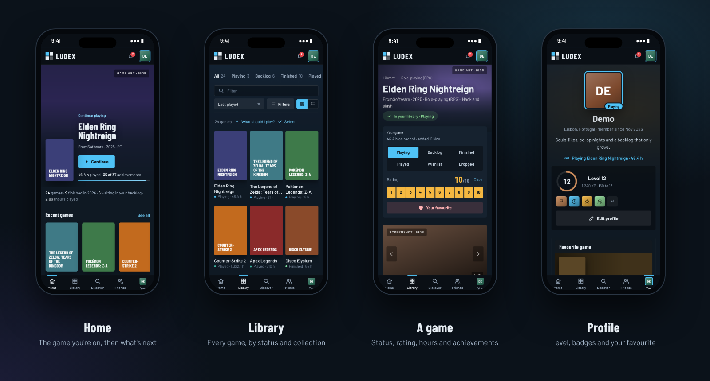
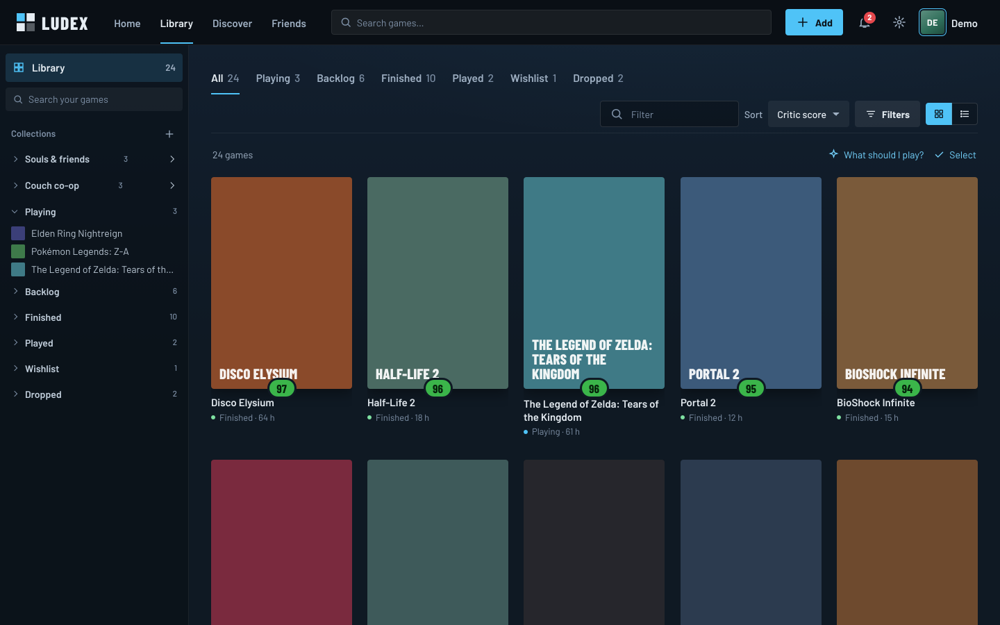
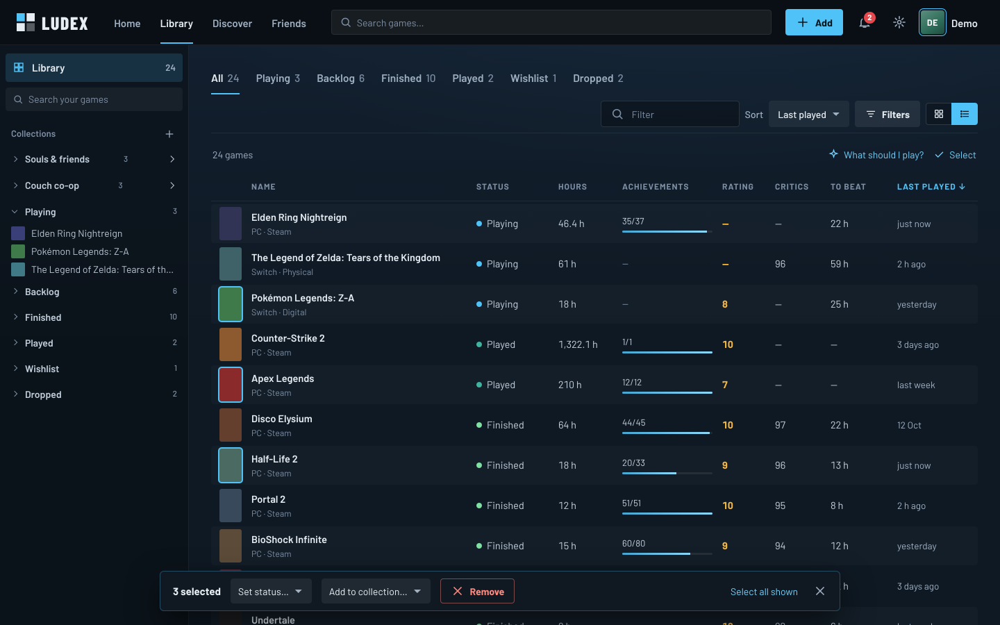
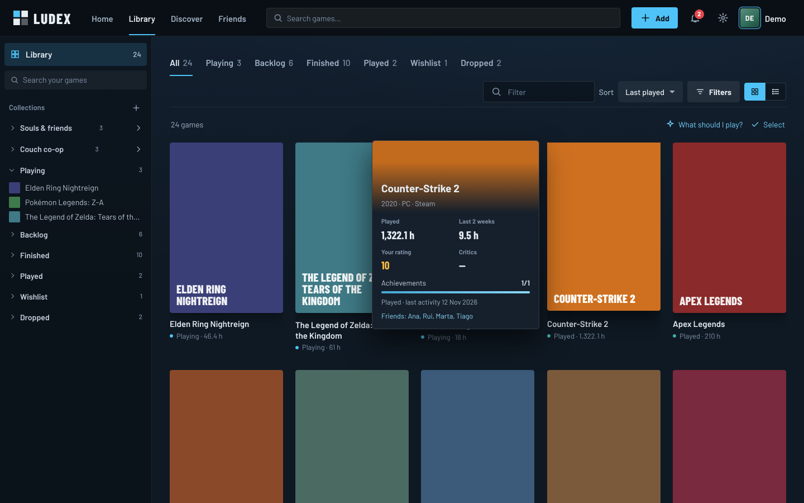
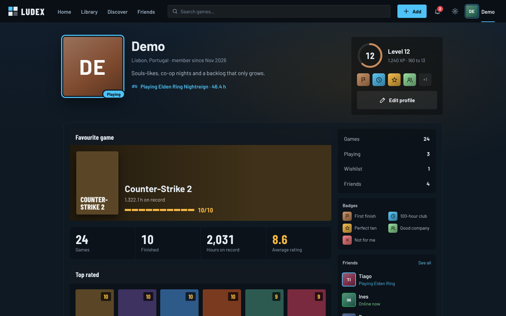
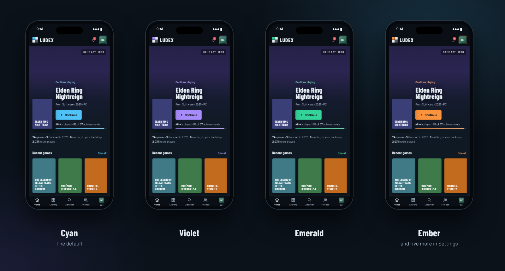

<p align="center">
  
</p>

<p align="center">
  A <b>self-hosted</b> game library in the spirit of Steam's and the old Metro for Steam: every game you've played,
  where you are with each one and what you thought of it, the covers, art and screenshots from <b>IGDB</b> — and which of
  your friends have the same games. On the phone and on the computer, on your own server.
</p>

<p align="center">
  
  
  
  
  
  
  
  
</p>

<p align="center">
  <a href="#features">Features</a> ·
  <a href="#screenshots">Screenshots</a> ·
  <a href="#deploying-on-the-nas">Deploying on the NAS</a> ·
  <a href="#the-game-catalog-igdb">IGDB</a> ·
  <a href="#steam-and-prices">Steam & prices</a> ·
  <a href="#playstation-and-playnite">PlayStation & Playnite</a> ·
  <a href="#sign-in-with-discord">Discord</a> ·
  <a href="#development">Development</a>
</p>

<p align="center">
  
</p>

> Game data, covers, artwork and screenshots come from [IGDB](https://www.igdb.com) (Twitch). Ludex keeps only the image
> ids: the pictures load straight from IGDB. (*Ludex* is Latin for a game, a play.)

---

## Features

**Home**

- **The game you're on** across the whole width, with its art, one **Continue** button, the hours and the
  achievements bar. Your numbers in one line under it: games, finished this year, the backlog, hours played.
- **Recent games**, then **Play next**: the backlog, best reviewed first, with the critic score beside each name.
  **Wishlist deals** when something you want is on sale or under your alert, and what your **friends** did lately.

**Library** (laid out like Steam's)

- **The library down the side**: your collections, then every game by status; the groups stay closed except Playing,
  and Ludex remembers the ones you open. It stays there when you open a game, like on Steam.
- **Status tabs** with counts (All, Playing, Backlog, Finished, Played, Wishlist, Dropped), a filter, a sort and one
  **Filters** button for the rest: platform (a family or one console), **store or format** (Steam, Epic Games, GOG…,
  physical or digital), a collection, only the games your friends have, and the cover size.
- **Clean covers**: the name and a status dot under each. A badge shows only for what you sort by: your rating,
  the **critic score** (green from 70, yellow below, like Steam) or the achievements.
- **11 sorts** like Steam's: last played, alphabetical, friends who have it, % of achievements, your rating, critic
  score, hours, hours in the last 2 weeks, shortest to beat, release date, date added. The cards move into place.
- **A list view** with sortable columns (hours, achievements, rating, critics, time to beat, last played).
- **Hover a cover** for a moment to see its hours, the last two weeks, your rating, the critics, achievements and the
  friends who have it.
- **Pick several** (Ctrl/⌘ + click, Shift + click for a run, or Select on the phone) and set their status, put them in a
  collection or remove them in one go — with **Undo** on every change, here and on the game page.
- **Which copy**: on a PC, the store it came from (Steam, Epic Games, GOG, EA app, Ubisoft Connect, Battle.net,
  Microsoft Store, Rockstar, itch.io); on a console, physical or digital — only what that console had (no digital
  NES or PS2 games, no physical iOS ones).

**Discover**

- **Search the whole IGDB catalog as you type**, with skeleton rows while it looks, and add a game as Playing,
  Finished or Wishlist in one tap — or open it first.
- **Six statuses**: Playing, Backlog, Finished (you reached the end), Played (games without an end, like CS2 or
  Minecraft, or ones you played but don't count as finished), Wishlist and Dropped.
- Each result says which of your friends have it.

**A game** (laid out like a game in Steam's library)

- A **screenshot viewer** with arrows, thumbnails, keys and swipe (open them full size), the header art with the cover,
  the summary and the facts: friends' rating ("Very positive · 8.0 from 3 friends"), release date, developer,
  publisher, genres and platforms.
- **Your game** bar: status and a **1–10 rating** that save as you tap, and **Make favourite** for your profile. Hours,
  platform and notes below.
- **Friends who have it**, with their photo, status, hours and rating, and their average; your playtime and dates.

**Collections, Steam, achievements, prices**

- **Your own collections** ("Favourites", "Souls-like"…) at the top of the sidebar: make one with +, drag games onto
  it from the grid or the sidebar, filter the library by it; put a game in or out from its page too.
- **Steam syncs on its own every day**: more hours, the hours of the last two weeks (on the profile and the cards),
  and games bought since come in as **Backlog** (games left out at the import stay out). "Sync now" on the Steam page.
- **PlayStation syncs every day too**: PS5 and PS4 games with their hours, PS3 and PS Vita games through their
  trophies, trophy counts on the cards; games played for the first time come in on their own.
- **Playnite**: every other launcher (Epic, GOG, EA app, Ubisoft Connect, Battle.net, Xbox, itch.io, emulators) from
  one CSV export, with hours, the store and Playnite's completion status.
- **Steam achievements**: the count on every card and a "% of achievements" sort; on the game page every
  achievement with its icon, when you unlocked it and how rare it is. Achievements give XP and three badges.
- **Critic score and time to beat** (IGDB): on the game page, and sorts by critic score and by shortest to beat.
- **What should I play next?**: say how much time you have and pick from the backlog or the wishlist; three
  suggestions, the better reviewed and the ones your friends have coming up more often.
- **Wishlist prices** (IsThereAnyDeal, with a free key): the best PC price of each wishlisted game, checked once a
  day, with its cut and lowest ever; set "alert me under" on the game page and the **bell** tells you.

**Profiles** (Steam style)

- A **profile photo** (shrunk to 256 px on the device before it's sent), a **bio**, a **location** and a **favourite
  game**, all in **Edit profile**.
- **Level and XP** from the library: 100 XP per finished game, 50 per played one, 20 per rating, 5 per game, 2 per
  achievement, 1 per hour. Level L starts
  at 100·(L−1)² XP, and the ring changes colour every ten levels.
- **22 badges** to earn: First finish, Finisher, Completionist, Hall of fame, 100-hour club, Marathoner, Thousand hours,
  Critic, Perfect ten, Tough crowd, Collector, Curator, Wishful thinking, Platform hopper, Retro soul, Day one, Good
  company, Year of play, Not for me, Platinum, Trophy cabinet, Achievement hunter — with progress on the ones still to get.
- **Playing now** and **Last seen**; showcases for the favourite game, the numbers, the top rated and recent activity;
  friends with what they're playing. Someone who isn't a friend sees the header and an **Add friend** button only.

**Friends**

- Ask anyone on your Ludex by user name; they accept or decline. Only friends see each other's games.
- The **bell** tells you about wishlist prices under your alert, games Steam or PlayStation added, and a PlayStation
  sign-in that needs renewing.
- What they've been up to, and their favourites you haven't played.

**Fluid on purpose**

- Covers **fly between pages**: tap one in the library and it becomes the game page's cover (View Transitions; the
  top bar stays put).
- Covers and art **blur up**: a tiny version blurred at once, the sharp one fading in over it — no empty boxes, no jumps.
- Things arrive in a quick cascade, buttons give under the finger, the home art drifts slowly. With "reduce motion" on,
  nothing moves. Only what moves is animated, so a big library stays smooth.
- A link to the page you're already on doesn't reload it: it just scrolls back to the top.

**Built to self-host**

- **No SQL Server of its own**: it uses the **shared SQL Server** already on the NAS (`shared-sql`, network `sql-net`)
  with **its own login** (`ludex`) that can only open the Ludex database. The one-shot **database deploy** creates the
  database and that login as sa, and brings both up to date on every update.
- **Sign in with Discord**: link it to an existing account in Settings (the password keeps working), or sign up with it.
- **Accounts for the house**: everyone has their own library; the first account (protected by a setup key) is the
  admin and can remove accounts. Sign-ups can be closed.
- **Phone and computer**: the same pages, a dock on the phone and a top bar on the computer; adds to the Home Screen
  like an app, and keeps clear of the iPhone's clock and battery. A calm dark look in Barlow Condensed, with
  **nine colour themes** (Cyan, Deep blue, Emerald, Lime, Gold, Ember, Crimson, Rose, Violet) in Settings that follow
  your account to every device.
- **Works without IGDB too**: until the Twitch credentials are set, a short built-in list of well-known games (no
  images) lets you try it.

## Screenshots

### On the phone


### On the computer
<table>
<tr>
<td width="50%"><b>Library</b><br></td>
<td width="50%"><b>Sorted by critic score</b><br></td>
</tr>
<tr>
<td width="50%"><b>List view and selection</b><br></td>
<td width="50%"><b>Hovering a cover</b><br></td>
</tr>
<tr>
<td width="50%"><b>A game</b><br></td>
<td width="50%"><b>Profile</b><br></td>
</tr>
</table>

### Colour themes


<details>
<summary>Settings → Appearance</summary>

</details>

The pictures use a demo account. Covers and art are drawn in each game's colour with its name; with IGDB they're the
real covers, art and screenshots.

## Deploying on the NAS

Ludex joins the other apps on Prometheus: its own folder in `/volume3/docker/self-hosted`, the **shared SQL Server**
and a **Portainer stack** managed by `apps.sh`. Run these over SSH.

**1. Get the code and fill in `.env`**

```bash
cd /volume3/docker/self-hosted
git clone https://github.com/rodrigocoelho2/Ludex.git Ludex
cd Ludex
cp .env.example .env
nano .env
```

- `SQL_SA_PASSWORD`: the same as in `shared-sql/.env`.
- `SQL_APP_PASSWORD`: a new password for the `ludex` login (letters and numbers; `.env.example` has a one-liner that
  makes one). Keep it in Vaultwarden. You don't create the login: db-deploy does.
- `LUDEX_API_KEY`, `LUDEX_SETUP_KEY`: two more random strings.
- `IGDB_CLIENT_ID`, `IGDB_CLIENT_SECRET`: see [the game catalog](#the-game-catalog-igdb).

**2. Build it, and make the volume for the sign-in keys**

```bash
sudo docker compose build
sudo docker volume create ludex_keys
```

**3. Add it to `apps.py` and create the stack**

In `/volume3/docker/_scripts/apps/apps.py`, add one line to `APPS`:

```python
    "ludex":      ("Ludex",      "ludex"),
```

then:

```bash
sudo bash /volume3/docker/_scripts/apps/apps.sh migrar ludex
```

The stack comes up in Portainer: `ludex-db-deploy` runs once and exits (database and login), then `ludex-webapi` and
`ludex-website`. Open `http://<nas-ip>:5098` and create the first account with the setup key.

**4. Reach it from outside** (optional): in Nginx Proxy Manager, a proxy host `ludex.prometheus-nas.com` →
`ludex-website`, port `8080` (the website is on `nas-net`).

**Updating** after a push to `main`:

```bash
sudo bash /volume3/docker/_scripts/apps/apps.sh atualizar ludex
```

It pulls, builds on the NAS, redeploys the stack (db-deploy applies any schema change) and cleans old images. If the
build fails, the running version stays.

### Anywhere else

`docker-compose.yml` expects a SQL Server called `shared-sql` on a Docker network called `sql-net`. With your own SQL
Server, set `SQL_SERVER` in `.env` to its container name (on `sql-net`) and run
`docker network create nas-net && docker compose up -d --build`.

## Steam and prices

- **Steam**: put a Steam Web API key in `.env` as `STEAM_API_KEY` ([steamcommunity.com/dev/apikey](https://steamcommunity.com/dev/apikey)),
  update Ludex, then **Settings → Steam**: your profile link or SteamID, a preview with what each game becomes, and
  **Import**. Your profile's game details must be public. After that it syncs on its own every day; **Sync now** is
  on the Steam page.
- **Wishlist prices**: a free [IsThereAnyDeal](https://isthereanydeal.com/apps/my/) key in `.env` as `ITAD_API_KEY`
  (and `LUDEX_PRICE_COUNTRY`, `PT` by default). Prices show on wishlisted games and on Home's deals.

## PlayStation and Playnite

Both need IGDB (they match games by name) and nothing else in `.env`.

- **PlayStation** (**Settings → PlayStation**): sign in at [playstation.com](https://www.playstation.com/), open
  [ca.account.sony.com/api/v1/ssocookie](https://ca.account.sony.com/api/v1/ssocookie) in the same browser, and paste the
  64-character `npsso` value. Ludex uses it once and keeps only Sony's refresh token, encrypted (AES-GCM, with a key
  derived from `LUDEX_API_KEY`). Review the games, **Import**, and from then on it syncs every day: more hours, trophy
  counts, new games. Sony's sign-in lasts about two months; the bell warns a week before, and a new NPSSO renews it.
  Ludex only reads; it uses the same calls as Sony's PlayStation App, which Sony doesn't document.
- **Playnite**: install the **Library Exporter Advanced** add-on, open its export window (Extensions → Library Exporter
  Advanced), tick **Sources, Platforms, Time Played, Completion Status, Last Played**, export all games, and upload the
  CSV at **Settings → Playnite**. Columns in any of Playnite's languages work. Steam games are left to the Steam import
  when Steam is connected. Upload again whenever you like: hours only go up and nothing you set is overwritten.

## Sign in with Discord

Optional:

1. At [discord.com/developers/applications](https://discord.com/developers/applications) make an application (one is
   enough for all your apps). In **OAuth2**, copy the **Client ID**, **Reset Secret** and copy the **Client Secret**,
   and under **Redirects** add `https://<where you open Ludex>/signin-discord` (one per address).
2. Put them in `.env` as `DISCORD_CLIENT_ID` and `DISCORD_CLIENT_SECRET`, and update Ludex.
3. Already have an account? Sign in with your password, open **Settings → Discord → Link Discord**. From then on
   **Sign in with Discord** opens that same account, with everything in it.
4. Someone new presses **Sign in with Discord** (or **Sign up with Discord**), picks a user name, and has an account
   with no password. They can add one in Settings; until then Discord can't be unlinked, so nobody gets locked out.

Ludex only asks Discord who you are (the `identify` scope). New accounts through Discord follow `LUDEX_ALLOW_REGISTRATION`:
with it off, a Discord account that isn't linked can't sign in and doesn't create one.

## The game catalog (IGDB)

IGDB is free and is used through a Twitch application:

1. Sign in at [dev.twitch.tv/console/apps](https://dev.twitch.tv/console/apps) (any Twitch account, with two-factor
   authentication on) and **Register Your Application**: any name, OAuth Redirect URL `http://localhost`, category
   *Application Integration*, client type *Confidential*.
2. **Manage** → copy the **Client ID**, press **New Secret** and copy the **Client Secret**.
3. Put them in `.env` as `IGDB_CLIENT_ID` and `IGDB_CLIENT_SECRET`, and update Ludex.

Ludex trades them for an app token (renewed on its own), searches IGDB as you type and copies a game into its database
when someone adds or opens it, refreshing it after 30 days. Settings shows which catalog is in use.

## Development

```
Ludex.Database   SQL Server project: tables, stored procedures, and the app login (post-deploy) → dacpac
Ludex.Library    shared enums, ServiceApiResponse, validation
Ludex.WebApi     the engine: accounts, the catalog (IGDB / built-in), libraries, friends, activity
Ludex.Sdk        typed client of the WebApi (the Website's only way in)
Ludex.Website    the app: ASP.NET Core MVC, Razor views, one stylesheet and one script, a PWA
Ludex.UnitTest   library rules, catalogs, platform names, name matching, Playnite and PlayStation, the SDK contract
```

- Every database call is a stored procedure through Dapper; no SQL in C#.
- The Website never references the WebApi: `Ludex.Sdk` carries copies of the DTOs, and a test checks they match.
- Builds and checks happen on the NAS (`apps.sh atualizar ludex`); the GitHub Actions workflow is kept but disabled.
- Locally: copy the two `appsettings.Development.json.example` files to `appsettings.Development.json`, point the
  WebApi at a SQL Server, and run both projects (`Ludex.WebApi` on :5099, `Ludex.Website` on :5098).

---

<p align="center"><sub>Ludex isn't affiliated with Valve, Steam, Sony, PlayStation, Playnite, Microsoft, Twitch or IGDB.</sub></p>
