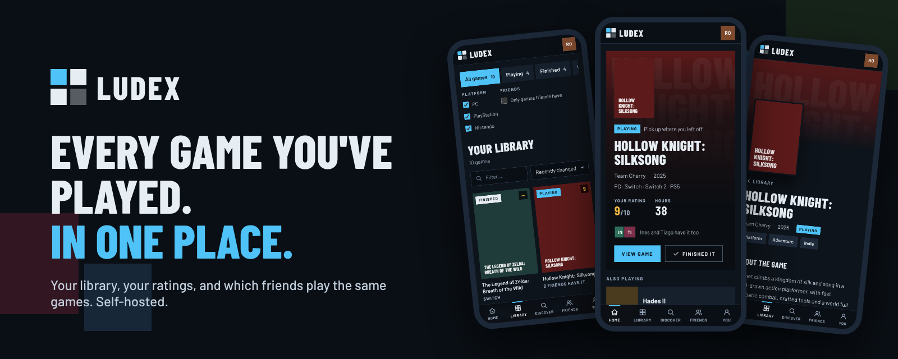
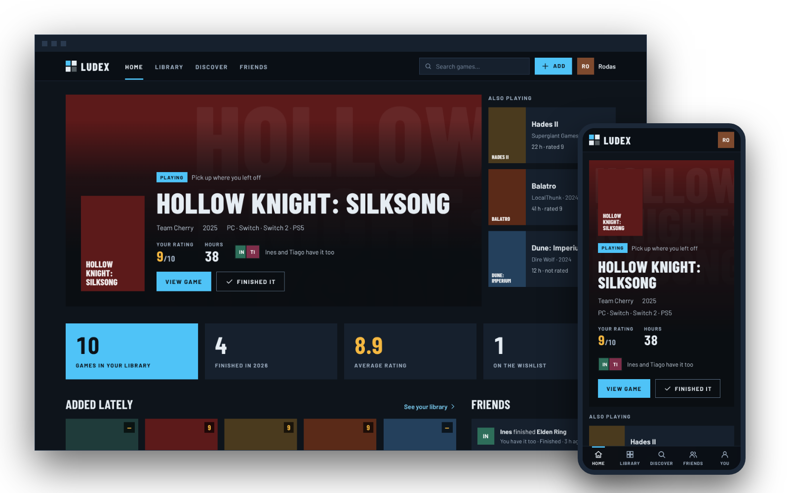
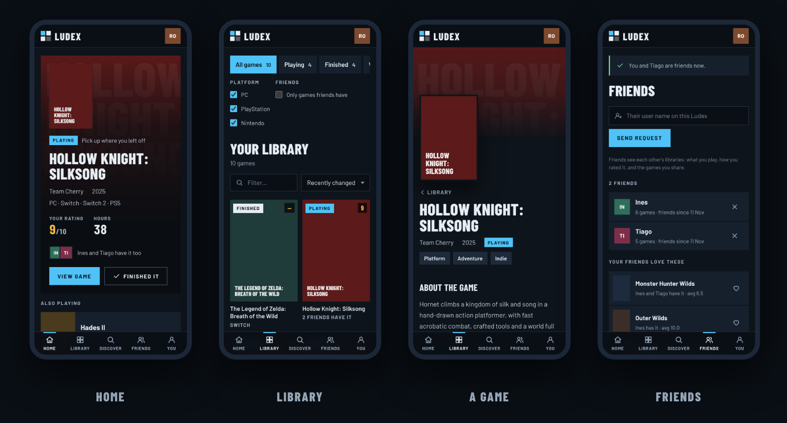
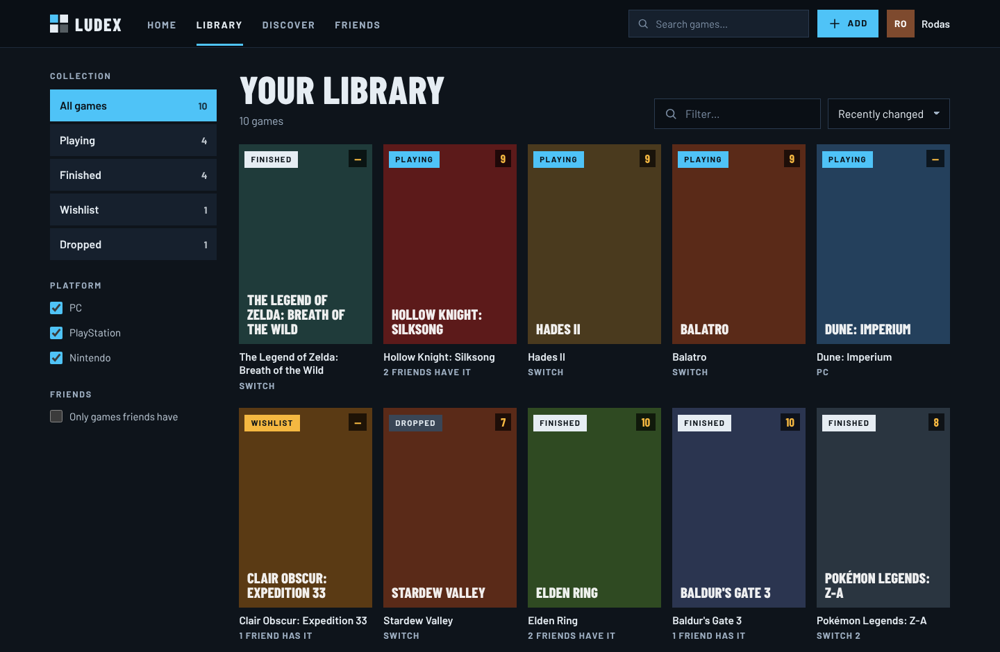
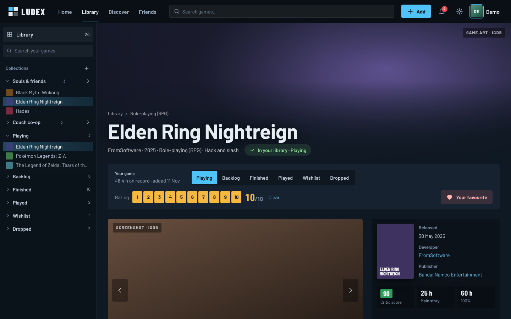
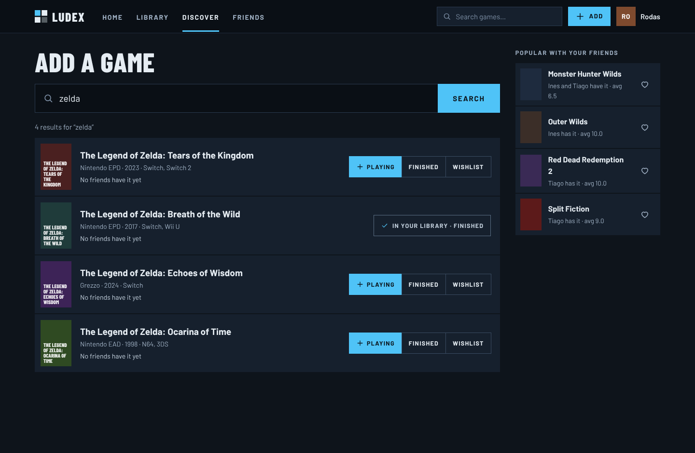
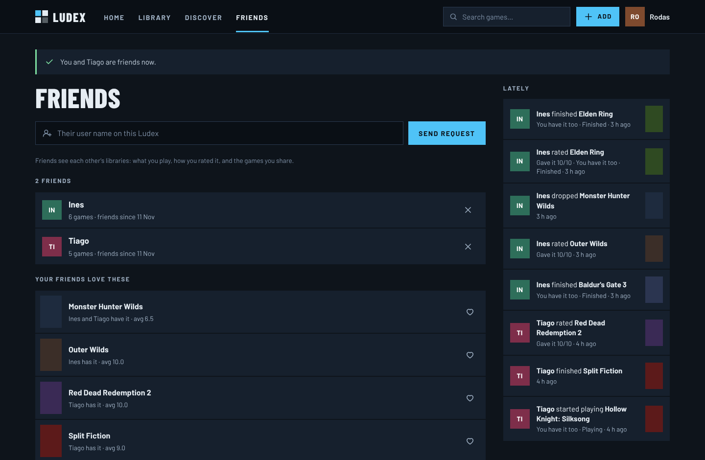
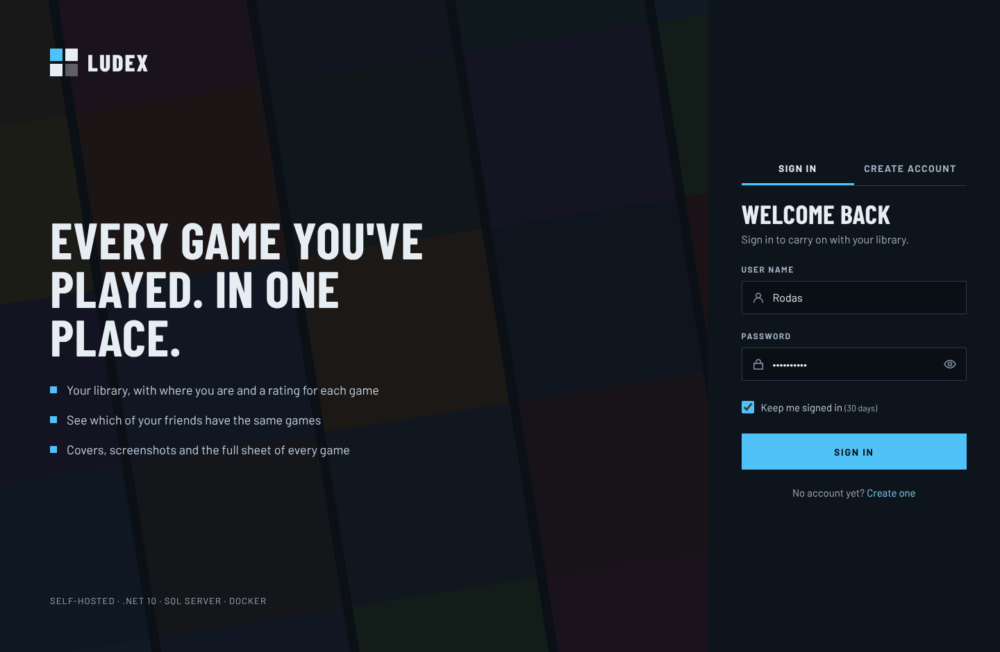
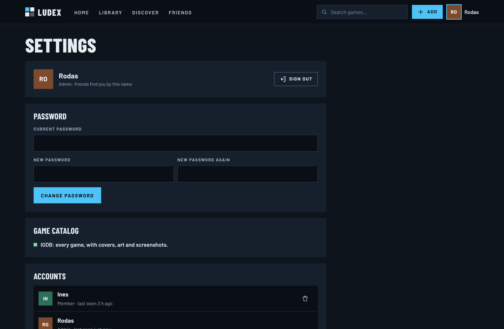

<p align="center">
  
</p>

<p align="center">
  A <b>self-hosted</b> game library in the spirit of Steam's and the old Metro for Steam: every game you've played,
  where you are with each one and what you thought of it, the covers, art and screenshots from <b>IGDB</b> — and which of
  your friends have the same games. On the phone and on the computer, on your own server.
</p>

<p align="center">
  
  
  
  
  
  
</p>

<p align="center">
  <a href="#features">Features</a> ·
  <a href="#screenshots">Screenshots</a> ·
  <a href="#deploying-on-the-nas">Deploying on the NAS</a> ·
  <a href="#the-game-catalog-igdb">IGDB</a> ·
  <a href="#development">Development</a>
</p>

<p align="center">
  
</p>

> Game data, covers, artwork and screenshots come from [IGDB](https://www.igdb.com) (Twitch). Ludex keeps only the image
> ids: the pictures load straight from IGDB. (*Ludex* is Latin for a game, a play.)

---

## Features

**Home**

- **The game you're playing** in a big hero with its art, your rating and hours, and the friends who have it too; the
  other games you're playing beside it. "Finished it" in one tap.
- **Your numbers** on flat Metro tiles that count up: games in the library, finished this year, average rating, wishlist.
- **Added lately**, and **what your friends did**: who finished, started, rated or wishlisted what, marked when you have
  the game too. And the **games your friends love** that you don't have yet, a heart away from your wishlist.

**Library** (laid out like Steam's)

- **The library down the side**, by status, with a search; it stays there when you open a game, so the game page
  sits next to it like on Steam.
- Every game as a cover with your **rating**, its status, the friends who have it, hours and **which copy** you own.
- Sort like Steam: last played, alphabetical, friends who have it, your rating, hours played, release date, date
  added. Filter by status, by **platform** (a family or one console: PS5, Switch…), by **copy** (physical, digital,
  Steam, Epic Games, GOG…) and to **only the games your friends have**. The cards rearrange with an animation.
- **Which copy**: on a PC, the store it came from (Steam, Epic Games, GOG, EA app, Ubisoft Connect, Battle.net,
  Microsoft Store, Rockstar, itch.io); on a console, physical or digital — only what that console had (no digital
  NES or PS2 games, no physical iOS ones).

**Discover**

- **Search the whole IGDB catalog as you type**, with skeleton rows while it looks, and add a game as Playing,
  Finished or Wishlist in one tap — or open it first.
- Each result says which of your friends have it.

**A game** (laid out like a game in Steam's library)

- A **screenshot viewer** with arrows, thumbnails, keys and swipe (open them full size), the header art with the cover,
  the summary and the facts: friends' rating ("Very positive · 8.0 from 3 friends"), release date, developer,
  publisher, genres and platforms.
- **Your game** bar: status and a **1–10 rating** that save as you tap, and **Make favourite** for your profile. Hours,
  platform and notes below.
- **Friends who have it**, with their photo, status, hours and rating, and their average; your playtime and dates.

**Collections, Steam, achievements, prices**

- **Your own collections** ("Favourites", "Souls-like"…) at the top of the sidebar: make one with +, drag games onto
  it from the grid or the sidebar, filter the library by it; put a game in or out from its page too.
- **Steam syncs on its own every day**: more hours, the hours of the last two weeks (on the profile and the cards),
  and games bought since come in as **Backlog** (games left out at the import stay out). "Sync now" on the Steam page.
- **Steam achievements**: the count on every card and a "% of achievements" sort; on the game page every
  achievement with its icon, when you unlocked it and how rare it is. Achievements give XP and three badges.
- **Critic score and time to beat** (IGDB): on the game page, and sorts by critic score and by shortest to beat.
- **What should I play next?**: say how much time you have and pick from the backlog or the wishlist; three
  suggestions, the better reviewed and the ones your friends have coming up more often.
- **Wishlist prices** (IsThereAnyDeal, with a free key): the best PC price of each wishlisted game, checked once a
  day, with its cut and lowest ever; set "alert me under" on the game page and the **bell** tells you.

**Profiles** (Steam style)

- A **profile photo** (shrunk to 256 px on the device before it's sent), a **bio**, a **location** and a **favourite
  game**, all in **Edit profile**.
- **Level and XP** from the library: 100 XP per finished game, 20 per rating, 5 per game, 1 per hour. Level L starts
  at 100·(L−1)² XP, and the ring changes colour every ten levels.
- **22 badges** to earn: First finish, Finisher, Completionist, Hall of fame, 100-hour club, Marathoner, Thousand hours,
  Critic, Perfect ten, Tough crowd, Collector, Curator, Wishful thinking, Platform hopper, Retro soul, Day one, Good
  company, Year of play, Not for me, Platinum, Trophy cabinet, Achievement hunter — with progress on the ones still to get.
- **Playing now** and **Last seen**; showcases for the favourite game, the numbers, the top rated and recent activity;
  friends with what they're playing. Someone who isn't a friend sees the header and an **Add friend** button only.

**Friends**

- Ask anyone on your Ludex by user name; they accept or decline. Only friends see each other's games.
- What they've been up to, and their favourites you haven't played.

**Fluid on purpose**

- Covers **fly between pages**: tap one in the library and it becomes the game page's cover (View Transitions; the
  top bar stays put).
- Covers and art **blur up**: a tiny version blurred at once, the sharp one fading in over it — no empty boxes, no jumps.
- Things arrive in a quick cascade, buttons give under the finger, the home art drifts slowly. With "reduce motion" on,
  nothing moves.

**Built to self-host**

- **No SQL Server of its own**: it uses the **shared SQL Server** already on the NAS (`shared-sql`, network `sql-net`)
  with **its own login** (`ludex`) that can only open the Ludex database. The one-shot **database deploy** creates the
  database and that login as sa, and brings both up to date on every update.
- **Accounts for the house**: everyone has their own library; the first account (protected by a setup key) is the
  admin and can remove accounts. Sign-ups can be closed.
- **Phone and computer**: the same pages, a dock on the phone and a top bar on the computer; adds to the Home Screen
  like an app. One dark Metro look: square tiles, Barlow Condensed capitals, cyan and gold.
- **Works without IGDB too**: until the Twitch credentials are set, a short built-in list of well-known games (no
  images) lets you try it — and lets CI take the screenshots.

## Screenshots

### On the phone


### On the computer
<table>
<tr>
<td width="50%"><b>Library</b><br></td>
<td width="50%"><b>A game</b><br></td>
</tr>
<tr>
<td width="50%"><b>Discover</b><br></td>
<td width="50%"><b>Friends</b><br></td>
</tr>
<tr>
<td width="50%"><b>Sign in</b><br></td>
<td width="50%"><b>Settings</b><br></td>
</tr>
</table>

The pictures show the built-in list of games, which has no images, so every cover is drawn in the game's colour with
its name; with IGDB they're the real covers, art and screenshots. CI takes them again, on a computer and a phone, on
every push (the `ci-output-compose` branch).

## Deploying on the NAS

Ludex joins the other apps on Prometheus: its own folder in `/volume3/docker/self-hosted`, the **shared SQL Server**
and a **Portainer stack** managed by `apps.sh`. Run these over SSH.

**1. Get the code and fill in `.env`**

```bash
cd /volume3/docker/self-hosted
git clone https://github.com/rodrigocoelho2/Ludex.git Ludex
cd Ludex
cp .env.example .env
nano .env
```

- `SQL_SA_PASSWORD`: the same as in `shared-sql/.env`.
- `SQL_APP_PASSWORD`: a new password for the `ludex` login (letters and numbers; `.env.example` has a one-liner that
  makes one). Keep it in Vaultwarden. You don't create the login: db-deploy does.
- `LUDEX_API_KEY`, `LUDEX_SETUP_KEY`: two more random strings.
- `IGDB_CLIENT_ID`, `IGDB_CLIENT_SECRET`: see [the game catalog](#the-game-catalog-igdb).

**2. Build it, and make the volume for the sign-in keys**

```bash
sudo docker compose build
sudo docker volume create ludex_keys
```

**3. Add it to `apps.py` and create the stack**

In `/volume3/docker/_scripts/apps/apps.py`, add one line to `APPS`:

```python
    "ludex":      ("Ludex",      "ludex"),
```

then:

```bash
sudo bash /volume3/docker/_scripts/apps/apps.sh migrar ludex
```

The stack comes up in Portainer: `ludex-db-deploy` runs once and exits (database and login), then `ludex-webapi` and
`ludex-website`. Open `http://<nas-ip>:5098` and create the first account with the setup key.

**4. Reach it from outside** (optional): in Nginx Proxy Manager, a proxy host `ludex.prometheus-nas.com` →
`ludex-website`, port `8080` (the website is on `nas-net`).

**Updating** after a push to `main`:

```bash
sudo bash /volume3/docker/_scripts/apps/apps.sh atualizar ludex
```

It pulls, builds on the NAS, redeploys the stack (db-deploy applies any schema change) and cleans old images. If the
build fails, the running version stays.

### Anywhere else

`docker-compose.yml` expects a SQL Server called `shared-sql` on a Docker network called `sql-net`. With your own SQL
Server, set `SQL_SERVER` in `.env` to its container name (on `sql-net`) and run
`docker network create nas-net && docker compose up -d --build`.

## The game catalog (IGDB)

IGDB is free and is used through a Twitch application:

1. Sign in at [dev.twitch.tv/console/apps](https://dev.twitch.tv/console/apps) (any Twitch account, with two-factor
   authentication on) and **Register Your Application**: any name, OAuth Redirect URL `http://localhost`, category
   *Application Integration*, client type *Confidential*.
2. **Manage** → copy the **Client ID**, press **New Secret** and copy the **Client Secret**.
3. Put them in `.env` as `IGDB_CLIENT_ID` and `IGDB_CLIENT_SECRET`, and update Ludex.

Ludex trades them for an app token (renewed on its own), searches IGDB as you type and copies a game into its database
when someone adds or opens it, refreshing it after 30 days. Settings shows which catalog is in use.

## Development

```
Ludex.Database   SQL Server project: tables, stored procedures, and the app login (post-deploy) → dacpac
Ludex.Library    shared enums, ServiceApiResponse, validation
Ludex.WebApi     the engine: accounts, the catalog (IGDB / built-in), libraries, friends, activity
Ludex.Sdk        typed client of the WebApi (the Website's only way in)
Ludex.Website    the app: ASP.NET Core MVC, Razor views, one stylesheet and one script, a PWA
Ludex.UnitTest   library rules, catalogs, platform names, passwords, the SDK contract
```

- Every database call is a stored procedure through Dapper; no SQL in C#.
- The Website never references the WebApi: `Ludex.Sdk` carries copies of the DTOs, and a test checks they match.
- **CI** builds everything, publishes the dacpac twice (the second run must change nothing), runs the tests, then runs
  the real `docker-compose.yml` against a stand-in `shared-sql`, fills it with three friends through the pages and
  takes every screenshot on a computer and a phone. Logs and screenshots land on the `ci-output-*` branches.
- Locally: copy the two `appsettings.Development.json.example` files to `appsettings.Development.json`, point the
  WebApi at a SQL Server, and run both projects (`Ludex.WebApi` on :5099, `Ludex.Website` on :5098).

---

<p align="center"><sub>Ludex isn't affiliated with Valve, Steam, Microsoft, Twitch or IGDB.</sub></p>
